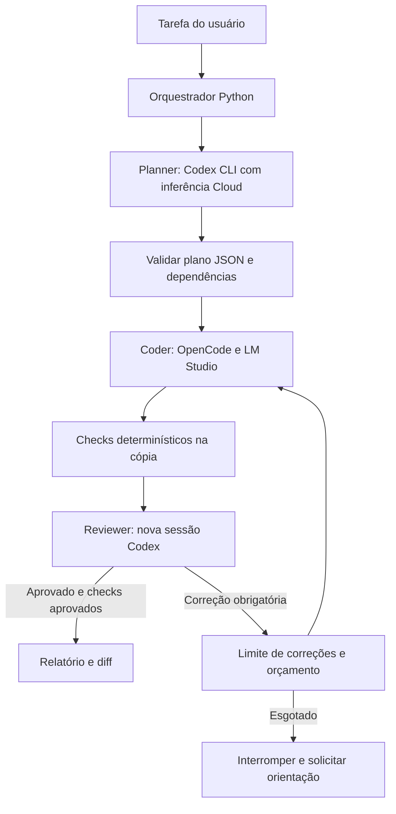

# Sistema multiagente BusGuard

Infraestrutura independente do FastAPI, MySQL, Docker e aplicativo Expo. Requer Python **3.12+**, Git, Codex CLI compatível, OpenCode **2.x** e LM Studio local. Usa apenas a biblioteca padrão Python; não instala dependências do projeto. A configuração é JSON para dispensar PyYAML.

## Arquitetura e permissões



Planner e Reviewer utilizam sessões novas de `codex exec`, com autenticação existente do CLI, sandbox `read-only`, configuração do usuário ignorada e ferramentas shell, code mode, browser, apps, plugins, MCP e delegação desativadas. Instruções de arquivos/skills não são descobertas automaticamente para essas sessões: somente o contexto selecionado é enviado, com limite próprio e detecção de padrões sensíveis. **Inferência Cloud via CLI não significa um job hospedado de `codex cloud exec`**: o subprocesso é local, mas o modelo é remoto. Não há implementação de API não documentada para controlar jobs hospedados.

O Coder usa `opencode run --standalone --format json`, em uma cópia do projeto com fronteira Git própria, sem commits ou hooks, para evitar descoberta do repositório pai. Snapshots Git internos do OpenCode são desativados. Configurações, plugins, credenciais e sessões do OpenCode do usuário não são reutilizados. Somente o provider `lmstudio` é habilitado. Permissões permitem leitura/edição dos arquivos necessários, negam shell, acesso externo, rede por ferramentas, instalação, delegação, LSP e formatadores. O orquestrador confere alterações por etapa e exige que o workspace permaneça idêntico durante os checks. Não há Coders simultâneos no mesmo workspace.

Cada tarefa recebe uma cópia dos arquivos de texto rastreados ou não ignorados pelo Git, incluindo modificações existentes. `.env*`, credenciais conhecidas, SQL/dumps, arquivos binários, arquivos grandes, diretórios de dependências, configurações de agentes e links são excluídos. O projeto principal nunca recebe alterações automaticamente. Não há commit, push, merge, migração nem operação Docker no fluxo.

**Uma cópia de arquivos não é sandbox de processos.** Análise AST e verificação de whitespace não executam a aplicação. `--allow-test-execution` autoriza executar código Python dos testes, que pode acessar recursos do usuário; use ambiente descartável com permissões adequadas para código não confiável. O filtro de conteúdo bloqueia padrões conhecidos de segredos/PII antes do envio Cloud, mas não é uma garantia de detecção de todos os dados pessoais. Revise arquivos selecionados e não forneça dados reais de alunos ou credenciais na tarefa.

## Preparar o ambiente no Windows

Execute na raiz do repositório:

```powershell
python --version
git --version
codex --version
codex exec --help
opencode --version
opencode run --help
lms --version
lms load --help
python .agent-system/orchestrator.py --status
```

O adaptador resolve o `.exe` nativo instalado pelo npm no Windows; não executa wrappers `.cmd`, `.bat` ou `.ps1` com conteúdo do modelo. Se necessário, configure caminhos absolutos em `cloud.executable` e `opencode.executable`. O preflight verifica flags compatíveis, sem inferência. O adaptador OpenCode foi conferido contra **2.0.16**, cuja ajuda difere dos exemplos antigos da documentação: usa `cwd` do subprocesso e não `--dir`.

Para autenticação Cloud, execute `codex login` no seu terminal e confirme com `codex login status`. Não é exigida uma chave de API separada. A infraestrutura não lê nem copia os tokens salvos e não os entrega ao Coder/testes. A disponibilidade da autenticação pode ser diferente no terminal e no sandbox do editor.

Abra o LM Studio, habilite o servidor local ou execute:

```powershell
lms server start
lms server status
lms ls --json
lms ps --json
Invoke-RestMethod http://localhost:1234/v1/models
```

O sistema consulta `/v1/models` e, quando disponíveis, os inventários nativos `/api/v1/models` ou `/api/v0/models`. Um servidor somente OpenAI-compatible pode listar IDs sem comprovar carregamento/contexto; essa informação permanece desconhecida. A conexão aceita somente HTTP loopback `/v1`, sem credenciais na URL. Redirecionamentos são bloqueados antes de seguir o destino. Servidores que exijam autenticação HTTP ainda não são suportados por este adaptador.

## GPUs, modelos e contexto

```powershell
nvidia-smi --query-gpu=index,name,memory.total,memory.free,memory.used,utilization.gpu --format=csv,noheader,nounits
python .agent-system/orchestrator.py --hardware
```

Cada GPU é apresentada separadamente. Duas placas de 8 GB não constituem um bloco de 16 GB. VRAM/RAM registradas são do sistema inteiro, incluindo outros processos; os dados não demonstram que o modelo está inteiramente em GPU nem quais camadas estão em cada placa. A distribuição fica `null` quando o runtime não a expõe.

[config.json](config.json) contém aliases, IDs reais, contexto, tokens máximos de saída e timeout por modelo. Os IDs iniciais foram obtidos desta instalação: `qwen3-14b` e `qwen/qwen3.6-35b-a3b`. O Qwen3 14B disponível era **Q4_K_M**, não Q5_K_M; ambos os modelos constavam como Q4_K_M no inventário. Verifique novamente com `--status`, pois instalação e carregamento podem mudar. Para experimentar Q5_K_M ou outro modelo, instale/carregue pelo LM Studio e configure o ID efetivamente retornado; o sistema não faz downloads.

Carregamento manual, sem presumir placement:

```powershell
lms load qwen3-14b --context-length 8192
lms load qwen/qwen3.6-35b-a3b --context-length 8192
```

Carregue um de cada vez quando necessário. O 35B instalado ocupa aproximadamente 22 GB em disco, além de KV cache/contexto e outras estruturas em memória; seu nome A3B não reduz o tamanho de todos os pesos ao de um modelo 3B. A capacidade de executar deve ser avaliada pelo runtime.

`--load-model` autoriza carregamento pelo comando nativo `lms load`, com o contexto configurado. Não descarrega modelos existentes. `local_llm.gpu.use_available_gpus=false` usa `--gpu off`; `true` deixa o placement ao LM Studio. `load_mode: "bionic-auto"` pode usar `--auto` no carregamento comum quando a instalação suportar Bionic. Não há distribuição manual de tensores. O preflight recusa um modelo comprovadamente descarregado, inexistente, de embeddings ou com contexto insuficiente. Os limites de contexto do OpenCode também são configurados; a janela inclui instruções, histórico e ferramentas.

## Executar tarefas

Fluxo completo: consome Cloud para planejar e revisar, implementa localmente:

```powershell
python .agent-system/orchestrator.py "Adicionar endpoint para consultar viagens por motorista"
python .agent-system/orchestrator.py --model qwen35b "Criar testes para autenticação JWT"
```

Escolha arquivos relevantes explicitamente para o Planner quando necessário:

```powershell
python .agent-system/orchestrator.py --context-file backend/app/routes/driver.py --context-file backend/app/services/trip_service.py "Revisar tratamento de ausência de viagem"
```

Sem seleção explícita, o Planner recebe inventário e excertos de AGENTS.md, agent.md e project.md. Não recebe o repositório inteiro nem tem ferramentas para buscar mais arquivos. Forneça contexto adicional quando um contrato exigir leitura detalhada; contexto insuficiente deve resultar em investigação ou validação pendente. O limite em caracteres é verificado antes de chamar Cloud, sem truncar silenciosamente diffs de revisão.

Modos distintos:

```powershell
# Não chama nenhum modelo; valida configuração/escopo/plano fornecido.
python .agent-system/orchestrator.py --dry-run --model qwen14b

# Chama Planner Cloud; não executa Coder nem aplica mudanças.
python .agent-system/orchestrator.py --plan-only "Implementar histórico de viagens"

# Tarefa pequena com escopo exato: nenhuma chamada Cloud.
python .agent-system/orchestrator.py --local-only --file docs/notas.md "Escrever notas de desenvolvimento"

# Reutilizar plano JSON, sem repetir Planner, mas com Reviewer Cloud.
python .agent-system/orchestrator.py --plan-file caminho/plan.json "Executar plano validado"

# Planner Cloud + Coder; sem Reviewer Cloud.
python .agent-system/orchestrator.py --no-reviewer "Atualizar documentação de um fluxo"
```

Os planos usam `task`, `acceptance_criteria`, `risks` e `steps`. Cada etapa exige `id`, `title`, `instructions`, `files`, `depends_on` e `checks`. Dependências precisam estar em ordem topológica. Arquivos são caminhos relativos exatos, sem globs, traversal, ADS/UNC, links ou nomes reservados. `schemas/` contém os contratos Cloud; validação Python também verifica semântica e contradições de revisão.

Checks disponíveis: `python-syntax` (AST Python 3.12 dos arquivos alterados), `diff-check` (whitespace/conflitos) e `unit-tests` (unittest em `tests/` da cópia). O backend existente usa outra organização; não há adaptação automática a toda suíte existente, MySQL, tipagem Expo ou testes nativos. Configure/crie uma suíte pertinente ao plano e não interprete checks estáticos como comprovação do comportamento. `unit-tests` precisa de `--allow-test-execution`; sem autorização a execução termina em `validation_pending`. Testes que alterem arquivos na cópia são rejeitados para manter coerência das evidências.

## Limites, economia e escalonamento

```powershell
python .agent-system/orchestrator.py --max-cloud-calls 2 --max-corrections 1 "Minha tarefa"
```

O orçamento conta invocações de sessões do CLI: é reservado antes da chamada e falhas também o consomem. Não representa um limite financeiro ou de tokens faturados, pois o CLI/conta define seu próprio consumo. Uso de tokens é extraído dos eventos quando disponível. Não há revisão após cada pequena edição: a revisão recebe o diff integrado e checks após todas as etapas. Correções operacionais/testes ocorrem localmente. `--plan-file` permite reutilização deliberada de planos; a revisão ainda deve corresponder ao resultado atual.

Erros repetidos interrompem no limite configurado. Escalonamento não ocorre automaticamente:

```powershell
python .agent-system/orchestrator.py --escalate-run .agent-system/runs/ID --confirm-cloud-escalation --max-cloud-calls 1
```

Esse comando autoriza novo planejamento Cloud baseado no impedimento registrado; não retoma/aplica mudanças antigas automaticamente. O resultado fica em uma nova execução. O estado e o motivo do escalonamento são auditáveis no relatório. Tarefas pequenas usam `--local-only`; decisões sobre arquitetura podem usar `--plan-only` com orçamento explícito.

## Benchmarks equivalentes

Benchmark padrão **não chama Cloud**. O arquivo [tasks.json](benchmarks/tasks.json) contém uma fixture sintética e testes fixos, independentes da aplicação. Cada modelo recebe o mesmo snapshot inicial, plano e tarefa, em uma pasta diferente. Os testes ficam fora do escopo editável da fixture. Não há aplicação de mudanças ao projeto principal.

```powershell
# Listar/configurar modelos e validar condições primeiro.
python .agent-system/orchestrator.py --status

# Autoriza troca sequencial e execução dos testes da fixture.
python .agent-system/orchestrator.py --benchmark --models qwen14b,qwen35b --manage-models --allow-test-execution

# Um modelo já carregado; sem gerenciar o runtime.
python .agent-system/orchestrator.py --benchmark --models qwen14b --allow-test-execution
```

`--manage-models` é autorização explícita para descarregar LLMs presentes, carregar um modelo por vez com `parallel=1`, contexto configurado e placement nativo, e recuperar modelos originais ao terminar. O inventário inicial e os comandos ficam em `model-session.json`. A recuperação restaura identificador, contexto e parallel expostos pelo inventário; configurações adicionais e placement exato não podem ser reproduzidos integralmente pelo CLI. Falhas de recuperação são registradas e geram código de saída 2. Sem essa opção, nenhum modelo é descarregado; o benchmark exige exclusividade e informa o impedimento quando outro LLM está carregado. Interromper à força o processo pode impedir a recuperação; consulte o arquivo de sessão e restaure manualmente pelo LM Studio.

Somente o Reviewer usa Cloud no benchmark quando as duas opções abaixo estiverem presentes; os planos fixos não são replanejados por modelo:

```powershell
python .agent-system/orchestrator.py --benchmark --models qwen14b,qwen35b --manage-models --allow-test-execution --cloud-benchmark --confirm-cloud-benchmark --max-cloud-calls 4
```

O orçamento Cloud é compartilhado por todo o benchmark. Contexto e timeout são registrados por alias; configure valores equivalentes se quiser comparar desempenho. VRAM disponível e uso de outras aplicações também afetam o resultado. Métricas desconhecidas permanecem `null`: duração total da chamada não é apresentada como tempo de inferência ou velocidade de geração. JSON contém tokens disponíveis, chamadas/erros de ferramentas, correções, checks, aprovação Cloud, pico e amostras por GPU, RAM do sistema e taxa de sucesso. Markdown contém tabelas comparativas. Sucesso local significa checks configurados aprovados, sem aprovação Cloud.

## Artefatos, testes e recuperação

Cada execução grava em `.agent-system/runs/ID/`: `report.json`, `report.md`, `plan.json`, `review.json`/`REVIEW.md` quando houver revisão, `changes.patch`, `baseline/`, `workspace/` e estado isolado do OpenCode. As pastas ficam ignoradas pelo Git. `--status` mostra execuções recentes. O relatório é atualizado nas transições e permanece disponível após falhas/timeout.

Estados finais: `completed` exige aprovação Cloud e checks; `local_verified` identifica execução sem essa aprovação; `planned` significa somente plano; `validation_pending`, `correction_limit`, `failed` e `interrupted` indicam impedimentos. Código de saída 0 para os três primeiros, 2 para impedimentos. O diff é produzido via Git e filtrado para padrões conhecidos de dados sensíveis; se `patch_redacted=true`, consulte o workspace local para revisar os trechos removidos e não aplique a versão filtrada cegamente.

Após interrupção, revise relatório, plano, diff e estado do runtime. Uma nova execução sempre começa em outra cópia; não descarta arquivos do usuário nem reseta o repositório. Para retomar trabalho já escrito, integre manualmente mudanças revisadas ou utilize uma cópia descartável como `--root`. Não execute patches redigidos por modelos sem revisão.

Testes da infraestrutura, sem inferência real:

```powershell
python -B -m unittest discover -s .agent-system/tests -v
```

Os testes utilizam mocks para provedores, indisponibilidade, OOM, revisões e orçamento. Também exercitam Git e um runner unittest real em diretórios temporários com código sintético. Não conectam a MySQL, não alteram Docker e não executam a aplicação.

A [verificação registrada](VERIFICATION.md) distingue a suíte automatizada, consultas reais, smoke de inferência local e integrações Cloud ainda não executadas.

Referências oficiais: [Codex não interativo](https://learn.chatgpt.com/docs/non-interactive-mode), [configuração Codex](https://learn.chatgpt.com/docs/config-file/config-reference), [OpenCode CLI](https://opencode.ai/docs/cli/), [permissões OpenCode](https://opencode.ai/docs/permissions/), [provider LM Studio no OpenCode](https://opencode.ai/docs/providers/#lm-studio), [inventário LM Studio](https://lmstudio.ai/docs/developer/rest/list), [lms load](https://lmstudio.ai/docs/cli/local-models/load). Interfaces da versão instalada prevalecem sobre exemplos antigos.
