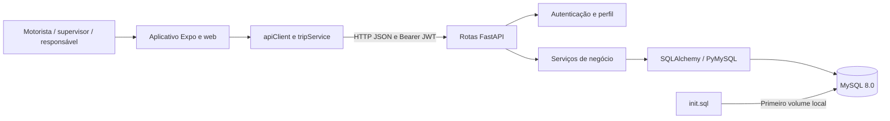

# BusGuard — documentação e análise técnica

**Data da análise:** 6 de outubro de 2026.

**Estado observado:** aplicação MVP, com API e aplicativo integrados e pendências relevantes antes de uso em produção. Os dados simulados não são mais carregados automaticamente nem exibidos como fallback no mobile.

BusGuard organiza transporte escolar: usuários, passageiros, responsáveis, motoristas, veículos, rotas, viagens e eventos de embarque/desembarque. A base já separa transporte HTTP, serviços, contratos e persistência. As prioridades são corrigir autorização por viagem, tornar falhas e dados demonstrativos explícitos e consolidar a evolução do banco.

Este documento descreve **o que existe** e identifica **melhorias propostas**. Para trabalhar no código, siga [agent.md](agent.md). O [README.md](README.md) contém instruções resumidas do ambiente de demonstração.

## 1. Escopo e limites da análise

Foram revisados os módulos Python do backend, telas, componentes e serviços TypeScript, configurações do aplicativo, manifests e lockfile, Docker, scripts SQL e documentação. Os arquivos MySQL Workbench foram inspecionados estruturalmente para inventariar as tabelas; os assets foram conferidos pelas referências de configuração.

A análise não examinou valores do `.env`, código de dependências instaladas ou dados reais do banco. A identificação de falhas de negócio e autorização vem da leitura do código; não houve exploração contra uma instância em execução. Os resultados das verificações locais estão na seção 13.

## 2. Produto e funcionalidades observadas

| Área | Implementação atual | Limite observado |
| --- | --- | --- |
| Autenticação | Login por e-mail/senha, JWT, consulta de perfil e restauração de sessão. | Sem refresh token ou revogação no servidor; cada requisição confere usuário e perfil atuais no banco. |
| Administração | API de criação, listagem, atualização e exclusão de cadastros e vínculos. | Não há painel administrativo dedicado no aplicativo. |
| Viagens | Cadastros e ações administrativas para iniciar, concluir e cancelar. | Atualização genérica permite alterar status e horários fora dessas ações. |
| Motorista | Tela com passageiros, contagem e marcação manual de embarque. | Leitura e marcação exigem vínculo do motorista ou supervisor à viagem; a deduplicação de eventos ainda não é atômica. |
| Responsável | Consulta da viagem e estado de embarque de passageiro vinculado. | Seleciona apenas o primeiro vínculo de filho encontrado. |
| Atualização | Telas consultam a API a cada 15 segundos. | Não há canal de atualização em tempo real nem rastreamento GPS. |
| Eventos | Persistência de `entry`/`exit` por passageiro e veículo. | Não registra viagem, autor ou origem; deduplicação não é atômica. |
| Demonstração | Arquivos de seed permanecem no repositório para desenvolvimento isolado. | O Compose não os carrega automaticamente; o endpoint de seed e o fallback mobile foram removidos. Volumes antigos podem conter dados de demonstração. |

As telas mobile agora exibem somente informações retornadas pela API e estados explícitos de erro ou ausência de viagem. Não há integração de mapa, rastreamento GPS, ETA, notificações, ligação, mensagens ou reconhecimento facial. O campo `facial` no cadastro não constitui uma integração biométrica.

## 3. Arquitetura atual

O backend é uma aplicação modular única. O aplicativo Expo acessa a API via `fetch`; a API usa SQLAlchemy e PyMySQL para acessar MySQL. O Compose sobe somente API e banco; o Expo é executado separadamente.



Fluxo de leitura: rota → dependências de autenticação/banco → serviço → consulta → schema de resposta. Fluxo de alteração: schema de entrada → serviço → persistência/commit → resposta. Há traduções de conflitos e recursos ausentes nas rotas, mas o tratamento de falhas de infraestrutura não é uniforme em todos os módulos.

```text
busguard/
├── AGENTS.md                  # Encaminhamento para as orientações gerais
├── agent.md                   # Regras de trabalho e verificação
├── project.md                 # Visão técnica e diagnóstico
├── README.md                  # Início rápido da demonstração
├── .env.exemple               # Modelo de configuração; nome existente
├── docker-compose.yml         # API e MySQL locais
├── backend/
│   ├── Dockerfile
│   ├── requirements.txt
│   └── app/
│       ├── main.py / database.py / security.py
│       ├── routes/            # auth, admin, driver, responsible, passengers, vehicles
│       ├── services/          # Casos de uso e consultas
│       ├── models/            # 15 entidades ORM
│       ├── schemas/           # Contratos e enums
│       └── scripts/           # Ajustes de dados de demonstração
├── database/                  # SQL, modelo Workbench e backup do modelo
└── mobile/busguard/
    ├── AGENTS.md / package.json / package-lock.json
    ├── app.json / tsconfig.json
    ├── app/                   # Login, abas, modal e páginas web
    ├── services/ / components/ / constants/
    └── assets/                # Ícones, splash e fonte
```

## 4. Tecnologias e versões

| Componente | Evidência local | Situação |
| --- | --- | --- |
| Python | [Dockerfile](backend/Dockerfile): `python:3.12-slim`. | Versão de execução prevista no container. |
| API | [requirements.txt](backend/requirements.txt): FastAPI e Uvicorn. | Sem versões fixadas. |
| Persistência | SQLAlchemy, PyMySQL e sessões síncronas. | Código usa `Mapped`, `mapped_column` e `DeclarativeBase`. |
| Validação | Pydantic via FastAPI; `model_dump` e `ConfigDict`. | Código requer API de Pydantic v2; não há pin explícito. |
| Autenticação | `python-jose[cryptography]`, `passlib[bcrypt]`, `bcrypt==4.0.1`. | JWT e hashes bcrypt; só bcrypt tem versão fixa. |
| Banco | [Compose](docker-compose.yml): `mysql:8.0`. | Tag sem patch/digest fixado. |
| Expo / Router | [package.json](mobile/busguard/package.json) e lockfile: `57.0.23` / `57.0.21`. | SDK 57; entrada `expo-router/entry`. |
| React / React Native | Lockfile: `19.2.3` / `0.86.3`. | Compatíveis com a família do SDK declarado. |
| TypeScript | Lockfile: `6.0.3`; [tsconfig.json](mobile/busguard/tsconfig.json) com `strict: true`. | Alias `@/*` e rotas tipadas habilitados. |
| Sessão nativa | `expo-secure-store`, configurado em `app.json`. | Cliente também tem implementação específica para web. |

O Expo SDK 57 documenta Node.js mínimo `22.13.x`. Como padronização do projeto, recomenda-se uma versão compatível da série Node 24, a partir de `24.3`, também aceita pelo `engines` de React Native no lockfile. Ainda não existe arquivo de versão do Node no repositório. [Referência oficial do SDK 57](https://docs.expo.dev/versions/v57.0.0/).

O lockfile npm é versão 3 e permite instalação com `npm ci`. O backend ainda depende da resolução de pacotes no momento do build; não é possível afirmar sua versão efetiva de FastAPI/SQLAlchemy apenas pelo `requirements.txt`.

## 5. Modelo de domínio e persistência

O bootstrap atual contém 15 tabelas. O modelo `diagram.mwb` possui o mesmo inventário de nomes; seu backup ainda usa os nomes antigos `responsible` e `passengers_responsible`.

| Tabelas | Papel e relações principais |
| --- | --- |
| `users` | Identidade, contatos, documentos, hash e perfil. Perfis: `admin`, `driver`, `responsible`, `supervisor`. |
| `addresses` | Endereços de passageiros, responsáveis e paradas. |
| `passengers` | Alunos/passageiros, data de nascimento, documentos, campo facial opcional e endereço. |
| `responsibles`, `passengers_responsibles` | Conta/endereço do responsável e vínculo de muitos passageiros com muitos responsáveis. |
| `cnh`, `drivers` | Habilitação e vínculo do motorista com usuário/CNH. |
| `vehicles`, `driver_vehicles` | Veículo, capacidade e associação com motoristas. |
| `supervisors` | Vínculo de usuário supervisor; `user_id` é único no SQL. |
| `routes` | Rota, turno (`morning`, `afternoon`, `evening`) e flag de atividade. |
| `route_stops` | Endereços ordenados por `sequence`; SQL exige unicidade de `(route_id, sequence)`. |
| `route_passengers` | Passageiros de uma rota e vínculo ativo; SQL exige unicidade de `(route_id, passenger_id)`. |
| `trips` | Rota, veículo, motorista, supervisor opcional, data, horários e estado da viagem. |
| `access_events` | Eventos `entry`/`exit`, com passageiro, veículo e timestamp. |

Referências operacionais: [init.sql](database/init.sql) e [modelos ORM](backend/app/models/__init__.py). A configuração de banco está em [database.py](backend/app/database.py), com sessão fechada ao fim da requisição e `pool_pre_ping=True`.

### Estados de viagem

O enum admite `scheduled`, `in_progress`, `completed` e `cancelled`. As ações de [admin_service.py](backend/app/services/admin_service.py) implementam:

| Ação | Validação atual | Efeito |
| --- | --- | --- |
| `start` | Rejeita `completed` e `cancelled`. | Marca `in_progress`, preserva ou define início e limpa término. |
| `finish` | Exige `in_progress`. | Marca `completed` e define término. |
| `cancel` | Rejeita `completed`. | Marca `cancelled` e define término; repetição redefine o horário. |

O CRUD de criação/atualização permite enviar estados e horários diretamente. Portanto, essas ações ainda não formam uma máquina de estados garantida em todas as entradas. Como evolução, concentre transições e invariantes em um serviço usado por todas as rotas e defina o comportamento de repetição de cada ação.

### Embarque e presença

`set_boarding_status` verifica existência da viagem, estado `in_progress` e participação ativa do passageiro na rota. Cria `entry` para `checked_in=true` e `exit` para `false`. Se o último evento já possui a ação solicitada, retorna `duplicated=true` sem criar outro evento.

Essa proteção funciona em requisições sequenciais, mas duas requisições concorrentes podem passar pela mesma consulta antes de gravar. Os eventos não têm `trip_id`; a consulta associa presença a veículo/passageiro e, quando disponível, ao limite inferior `started_at`. Não há limite superior nem proteção explícita contra viagens simultâneas no mesmo veículo.

`_build_boarding_students` ordena alunos por nome e cria uma sequência a partir dessa ordenação. `_next_stop_address` ordena por ID de endereço. Nenhuma delas utiliza `route_stops.sequence`, embora a interface apresente ordem/próxima parada.

## 6. API e contratos

Com a API iniciada, a documentação automática fica em [Swagger UI local](http://localhost:8000/docs), [ReDoc local](http://localhost:8000/redoc) e [OpenAPI local](http://localhost:8000/openapi.json).

| Método e caminho | Acesso verificado atualmente | Uso |
| --- | --- | --- |
| `GET /health` | Público. | Retorna `{"status":"ok"}`; não consulta o banco. |
| `POST /auth/login` | Público. | JSON com `email` e `password`; retorna `access_token` e `token_type`. |
| `GET /auth/me` | Bearer JWT válido e conta existente com mesmo perfil. | Retorna `id` e `role` atuais do banco. |
| `GET /driver/trips/current` | `driver` ou `supervisor` vinculado. | DTO mobile da viagem ativa autorizada. |
| `POST /driver/trips/{trip_id}/boarding` | `driver` ou `supervisor` vinculado à viagem. | JSON com `passenger_id` inteiro positivo e `checked_in`, ambos obrigatórios. |
| `GET /responsible/children/current-trip` | `responsible`, `admin`. | Viagem de um passageiro vinculado ao usuário. |
| CRUD `/admin/...` | `admin`. | Cadastros e vínculos listados abaixo. |
| `POST /admin/trips/{trip_id}/start`, `/finish`, `/cancel` | `admin`. | Ações de viagem. |
| `POST /passengers/` | `admin`. | Cadastro de passageiro com verificação prévia do endereço. |
| `POST /vehicles/access` | `admin`. | Evento de entrada/saída. |
| `GET /vehicles/{vehicle_id}/passengers` | `admin`. | IDs atualmente a bordo segundo último evento por passageiro. |

Recursos CRUD administrativos: `addresses`, `users`, `passengers`, `vehicles`, `cnh`, `drivers`, `driver-vehicles`, `responsibles`, `passenger-responsibles`, `routes`, `route-stops`, `route-passengers`, `supervisors`, `trips`. Oferecem `GET/POST` na coleção e `PUT/DELETE` por `{record_id}`; não há `GET` individual nessas rotas. Listagens usam `limit=100` e `offset=0`, sem limites declarados de validação. Os `PUT` atuais aceitam campos parciais com `exclude_unset=True`.

Referências: [rotas administrativas](backend/app/routes/admin.py), [autenticação](backend/app/routes/auth.py), [contratos mobile](backend/app/schemas/mobile_trips.py) e [cliente de viagens](mobile/busguard/services/tripService.ts).

No pedido de embarque, `passenger_id` igual a zero ou negativo retorna HTTP 422 para um usuário com perfil autorizado, antes de chamar o serviço. `checked_in=false` continua representando desembarque; o campo permanece obrigatório. A mudança não altera as verificações de vínculo com a viagem.

Há uma diferença entre a declaração de segurança e o endpoint de login: `OAuth2PasswordBearer` aponta para um endpoint que recebe JSON, enquanto o fluxo OAuth2 de senha usado normalmente pelo Swagger envia formulário. O aplicativo envia JSON corretamente; o fluxo de autorização da documentação deve ser revisado. Não foi validado em execução nesta análise.

## 7. Autenticação, sessão e privacidade

[security.py](backend/app/security.py) cria tokens com `sub`, `role` e `exp`; usa `HS256` e duração padrão de 30 minutos, configuráveis. A chave JWT é obrigatória para emitir/validar tokens, mas sua ausência é detectada durante o uso, e não no início da API.

`get_current_user` valida o token e confere no banco a existência do usuário e a igualdade do perfil atual com o claim. Exclusão de usuário e mudança de perfil invalidam o token; mudança de senha e logout ainda não o revogam no servidor. O logout mobile remove apenas a cópia local. Não há limitação explícita de tentativas de login nem mecanismo de refresh/revogação.

O cliente guarda token em memória e em SecureStore nas plataformas nativas. Na web, a sessão fica só em memória e é perdida ao recarregar; tokens antigos em `localStorage` são removidos quando o app inicia. Isso reduz a persistência, mas não elimina o risco de XSS durante uma sessão ativa. Para uma sessão web persistente de produção, avaliar cookies `HttpOnly`, `Secure` e `SameSite`, acompanhados do desenho de CSRF/CORS. [Orientação OWASP para armazenamento web](https://cheatsheetseries.owasp.org/cheatsheets/HTML5_Security_Cheat_Sheet.html).

O tutorial atual do FastAPI usa PyJWT e `pwdlib`, com Argon2 recomendado para novos hashes. Uma modernização do projeto deve avaliar compatibilidade e migração gradual dos hashes bcrypt existentes, sem invalidar contas ou atualizar bibliotecas às cegas. [Referência FastAPI de JWT e senhas](https://fastapi.tiangolo.com/tutorial/security/oauth2-jwt/).

O domínio inclui dados de crianças, documentos, endereços e campo facial. Antes de usar dados reais, documentar finalidade, base legal aplicável, acesso, retenção, eliminação e responsabilidades. Biometria vinculada a uma pessoa é dado pessoal sensível, e o tratamento de dados de crianças deve observar seu melhor interesse. A revisão de código não comprova conformidade legal. [LGPD, especialmente arts. 5º, 6º, 11 e 14](https://www.planalto.gov.br/ccivil_03/_ato2015-2018/2018/lei/l13709.htm).

## 8. Execução local

### Pré-requisitos

- Docker com engine Linux ativo e Docker Compose v2 para API/MySQL.
- Node.js compatível com o SDK/lockfile e npm para o aplicativo.
- Portas `8000`, `3307` e uma porta Expo disponível; a configuração CORS atual cobre `8081`, `8082` e `19006` em `localhost`.
- Para Android/iOS, dispositivo ou emulador compatível com Expo SDK 57. A compatibilidade de Expo Go/build nativo deve ser conferida na documentação versionada.

### API e banco no PowerShell

Execute a partir da raiz. Crie a configuração somente se ela não existir:

```powershell
if (-not (Test-Path -LiteralPath '.env')) {
    Copy-Item -LiteralPath '.env.exemple' -Destination '.env'
}
```

Edite o `.env` local: configure uma chave JWT própria, aleatória e de alta entropia; alinhe a URL do banco com o Compose. Preserve configurações existentes. Depois:

```powershell
docker compose config --quiet
docker compose up -d --build
docker compose ps
Invoke-RestMethod http://localhost:8000/health
```

Para diagnóstico, use `docker compose logs --tail 100 api mysql`, cuidando de não compartilhar dados pessoais ou segredos que eventualmente apareçam nos logs. Um `503` no login pode indicar MySQL ainda inicializando; `/health` sozinho não comprova prontidão do banco.

O primeiro volume MySQL recebe apenas `init.sql`. Scripts em `/docker-entrypoint-initdb.d` não são reaplicados a um volume já existente. Volumes antigos podem continuar com dados de demonstração; não apague o volume sem confirmar que os dados podem ser descartados.

### Aplicativo web

Partindo da raiz, em outro terminal:

```powershell
Set-Location mobile/busguard
npm ci
$env:EXPO_PUBLIC_API_BASE_URL = 'http://localhost:8000'
npm run web
```

Para uso nativo, configure `EXPO_PUBLIC_API_BASE_URL` com uma URL que o dispositivo alcance e execute `npm start` ou o script da plataforma. Em telefone físico, normalmente use o IP LAN do computador na mesma rede; `localhost` aponta para o próprio telefone. No emulador Android padrão, `10.0.2.2:8000` pode alcançar o host. O `apiClient` tenta inferir o host do Expo e possui fallbacks, mas a configuração explícita é preferível.

A versão web usa `web.output: static` em `app.json`; uma exportação web não inclui a API nem o MySQL. Não foi encontrada configuração de deploy/EAS versionada.

### Contas de demonstração

O Compose não cria contas de demonstração. No modo de desenvolvimento, a tela de login preenche e-mail e senha do motorista da fixture para facilitar testes; em builds de produção, os campos começam vazios. O arquivo [login.tsx](mobile/busguard/app/login.tsx) comenta as credenciais de admin, motorista e responsável para testes locais. O arquivo `database/megamock.sql` permanece apenas como fixture manual para ambiente isolado de desenvolvimento. A conta precisa existir no banco para autenticar; bancos já inicializados podem conservar contas antigas.

### Testes do backend

Em um ambiente Python de desenvolvimento com as dependências instaladas, execute a partir de `backend/`:

```powershell
python -m pip install -r requirements-test.txt
python -B -m unittest discover -s tests -v
```

[requirements-test.txt](backend/requirements-test.txt) inclui as dependências da API e o cliente HTTP `httpx` usado somente nos testes. Os testes de embarque exercitam o schema e a rota real com banco, autenticação e serviço isolados. Os testes de autorização usam SQLite em memória; não substituem a validação com MySQL nem um fluxo completo de login no ambiente da aplicação.

## 9. Configuração de ambiente

| Variável | Uso | Observação |
| --- | --- | --- |
| `DATABASE_URL` | Conexão SQLAlchemy. | No container: `mysql+pymysql://<usuario>:<senha>@mysql:3306/app_db`. No host, o MySQL é publicado em `localhost:3307`. |
| `JWT_SECRET_KEY` | Assinatura/validação JWT. | Obrigatória para autenticação; nunca pública nem versionada. |
| `JWT_ALGORITHM` | Algoritmo JWT. | Padrão `HS256`; configure uma política explícita de algoritmos permitidos. |
| `JWT_ACCESS_TOKEN_EXPIRE_MINUTES` | Validade do token. | Padrão `30`; precisa de inteiro válido. |
| `APP_NAME` | Título da API. | Opcional; padrão `BusGuard API`; não está no template atual. |
| `EXPO_PUBLIC_API_BASE_URL` | Endereço da API no aplicativo. | Opcional no código atual; deve ser definido por ambiente de distribuição. |

O `.env` da raiz é carregado pelo `env_file` do serviço API. O backend não possui carregador próprio de `.env`; uma execução Python fora do Compose exige exportar essas variáveis antes dos imports. O Expo usa seu próprio contexto de execução em `mobile/busguard`.

Credenciais MySQL estão fixas no Compose para demonstração. Alterar somente `DATABASE_URL` não muda as credenciais do serviço MySQL. `database.py` ainda corrige automaticamente `@mysql:3307/` para `@mysql:3306/`; é uma compatibilidade local que convém substituir por validação explícita de configuração.

Variáveis com prefixo `EXPO_PUBLIC_` são incorporadas ao aplicativo e podem ser lidas por seus usuários. Elas não devem conter segredos. [Documentação oficial do Expo](https://docs.expo.dev/guides/environment-variables/).

## 10. Diagnóstico e prioridades

Prioridades propostas para orientar o trabalho: **P0** deve ser resolvido antes de disponibilizar a aplicação a usuários reais; **P1** consolida integridade, segurança e operação; **P2** melhora manutenção e experiência. Os itens não representam correções já executadas.

### P0 — isolamento de acesso e veracidade da informação

| ID | Evidência | Impacto e ação recomendada |
| --- | --- | --- |
| P0-01 | Corrigido em 8 de outubro de 2026: leitura de viagem filtra motorista ou supervisor vinculado. | Verificar em teste de integração com MySQL antes de uso real. |
| P0-02 | Corrigido em 8 de outubro de 2026: embarque recebe identidade e exige vínculo com a viagem. | Verificar em teste de integração com MySQL antes de uso real. |
| P0-03 | Corrigido em 8 de outubro de 2026: aplicativo removeu fallback mock; telas não mantêm viagem após erro. | Validar a experiência em Android, iOS e web com API indisponível e sessão expirada. |
| P0-04 | Compose não carrega seed e o endpoint de seed foi removido em 8 de outubro de 2026. O preenchimento do motorista foi habilitado somente no modo de desenvolvimento em 9 de outubro. | Limpar apenas ambientes antigos cujo conteúdo tenha sido avaliado; proteger fixtures remanescentes de uso em produção. |

Os dois primeiros itens são avaliação de risco a partir do código e se enquadram no problema de autorização por objeto descrito pela [OWASP API Security](https://api-security.owasp.org/editions/2023/en/0xa1-broken-object-level-authorization/).

### P1 — integridade, segurança e operação

| ID | Evidência | Ação recomendada |
| --- | --- | --- |
| P1-01 | [init.sql](database/init.sql) usa PK composta `(id, users_id)` em `responsibles`; [modelo ORM](backend/app/models/responsibles.py) usa apenas `id`. Constraints compostas de unicidade de rotas/vínculos também não constam nos modelos. | Reconciliar SQL e ORM, definir baseline e introduzir migrações versionadas com verificação de drift. |
| P1-02 | Eventos sem vínculo de viagem/autor e deduplicação por consulta seguida de insert. | Modelar proveniência e idempotência/concorrência; planejar migração dos históricos sem inventar associações. Definir índices segundo consultas reais. |
| P1-03 | [TripUpdate](backend/app/schemas/trips.py) e CRUD genérico alteram estado/horários; início não verifica conflitos de atribuição. | Concentrar transições; validar rota ativa, motorista/veículo, capacidade e conflitos conforme regras acordadas. |
| P1-04 | Conta e perfil atuais agora são conferidos em cada requisição. | Definir revogação por logout/senha, rotação de chave e controle de tentativas. |
| P1-05 | `restoreSession` diferencia falha de rede de token inválido; `apiFetch` centraliza `401`, trata `204` e limita requisições a 10 segundos. | Ampliar cancelamento por ciclo de vida da tela e política uniforme para `403`. |
| P1-06 | `AlunoItem` usa valor controlado; embarque espera confirmação antes de atualizar e bloqueia toques repetidos. | Validar disputas entre polling e operação em andamento nas plataformas. |
| P1-07 | [trip_service.py](backend/app/services/trip_service.py) escolhe só um filho, ignora sequência de paradas e consulta o último evento separadamente para cada aluno. | Suportar seleção de filhos, definir associação aluno/parada e agrupar consultas para eliminar o padrão N+1. |
| P1-08 | `datetime.now()` sem fuso nas ações/seeds; banco mistura `DATETIME` e `TIMESTAMP`. | Definir política de UTC e data operacional, configurar fusos e migrar dados antigos com critérios explícitos. |
| P1-09 | Parcial: `passenger_id` do embarque exige valor positivo. Listagens continuam sem teto de `limit`; e-mail é `str`; CPF/RG/CNH têm sobretudo limites de tamanho; updates aceitam `null` em campos persistidos obrigatórios. | Ampliar validação dos demais identificadores, limites, formatos e coerência do domínio; tornar atualizações previsíveis e erros consistentes. |
| P1-10 | Há testes de autorização mobile e contrato HTTP de embarque em `backend/tests/`; lint/format e CI ainda não estão configurados. | Ampliar testes de autorização, transições, eventos e sessão; adicionar gates de tipagem, qualidade e migrações em cada PR. |
| P1-11 | Compose sem healthchecks; `/health` não verifica DB; imagens usam reload, credenciais locais e publicação da porta MySQL. | Criar prontidão do banco, healthchecks, configuração de produção, usuário de container sem privilégios e gestão de segredos/rede. |
| P1-12 | Backend sem lock completo; ausência de auditoria de dependências e de operação documentada. | Travar resolução compatível, revisar vulnerabilidades, configurar logs/identificadores de requisição, métricas, backups e ensaiar restauração. |
| P1-13 | [PassengerRead](backend/app/schemas/passengers.py) herda `facial`; não há política documentada de retenção/auditoria. | Minimizar DTOs, restringir acesso a biometria e formalizar controles de privacidade e preservação do histórico. |

O `depends_on` atual ordena o início dos containers, mas não espera o banco estar pronto. A evolução deve usar healthcheck e condição de prontidão, além de tratamento de falhas de conexão. [Documentação Docker Compose](https://docs.docker.com/compose/how-tos/startup-order/).

### P2 — limpeza e manutenção

- Consolidar `init.sql`/`create_tables.sql` após estabelecer migrações. Preservar rastreabilidade do modelo Workbench; o `.bak` contém nomes antigos.
- Corrigir ou arquivar `inserts_test.sql`, que omite campos obrigatórios de passageiros e termina com um `show` incompleto. `cnh.sql` referencia `condutores`, tabela ausente do esquema atual. Esses scripts não compõem uma suíte de testes.
- Retirar `delete_all_rows.sql` do fluxo normal: a ordem tenta excluir `routes` antes de `trips`, contrariando FKs. O script também mistura DELETE e ALTER sem recuperação de estado parcial.
- Padronizar o nome `.env.exemple` para `.env.example` em uma alteração que atualize suas referências; documentar versões de ferramentas e exemplos por ambiente.
- Organizar estado de sessão e carregamento compartilhado; revisar ocultação de abas, acesso direto a rotas e inicialização antes de conhecer o perfil.
- Revisar componentes do template, modal de exemplo, textos em inglês, `lang="en"`, acessibilidade e cores fixas que prejudicam o tema escuro.
- Especificar contrato de erros e estratégia de evolução da API. Caso se adote `PATCH` ou prefixo versionado, planejar a compatibilidade com clientes existentes.
- Definir autoria/licença do projeto inteiro. A licença MIT presente no mobile menciona o template Expo; ela não resolve, por si só, a política de licenciamento do backend e do restante do repositório.

## 11. Roteiro recomendado

| Etapa | Entrega | Critério verificável de saída |
| --- | --- | --- |
| 1. Acesso e demonstração | Corrigir P0, separar mocks, bloquear seed fora de desenvolvimento. | Dois motoristas não leem/alteram viagens entre si; supervisão exige vínculo; API fora do ar não mostra mock como informação atual. |
| 2. Persistência | Reconciliar modelos/SQL, baseline Alembic, eventos vinculados e transações. | Banco novo e banco migrado convergem; eventos repetidos/concorrentes obedecem à regra; recuperação de migração é documentada. |
| 3. Qualidade | Testes essenciais, lint/format, lock Python e pipeline. | Instalação limpa reproduz dependências; PR executa verificações de contrato, autorização e tipagem. |
| 4. Operação | Configuração de produção, HTTPS, prontidão, auditoria, métricas e backup. | Credenciais de demo não funcionam em produção; readiness detecta DB indisponível; restauração é ensaiada. |
| 5. Produto | Múltiplos filhos, paradas reais, acessibilidade e funcionalidades faltantes. | Fluxos aceitos com os responsáveis do produto e testados nas plataformas de distribuição. |

Este roteiro mantém a arquitetura atual. Não há evidência de necessidade imediata de microserviços, filas ou orquestração complexa. Integrações GPS, notificações e reconhecimento facial devem ser especificadas como funcionalidades próprias, com custos, privacidade e critérios de validação.

## 12. Qualidade e operação desejadas

As seguintes práticas são propostas; as ferramentas ainda precisam ser configuradas:

- **Backend:** Ruff para lint/formatação; pytest e cliente de teste HTTP para casos de uso e contratos; tipagem estática adotada gradualmente.
- **Mobile:** ESLint/formatador compatíveis com o SDK, checagem TypeScript e testes de componentes para sessão, embarque, erros e acessibilidade. Escolher ferramentas compatíveis com Expo/React Native instalados.
- **Integração:** MySQL isolado para FKs, enums, unicidade, transações, bootstrap e migrações. SQLite não deve ser a única evidência de compatibilidade com MySQL.
- **Fluxos completos:** login → viagem autorizada → embarque → leitura pelo responsável → logout/expiração; incluir API indisponível e persistência após reinício.
- **CI:** instalações reproduzíveis, lint/format, tipagem, testes relevantes, checagem de migrações e auditoria de dependências/segredos, com resultado visível em cada PR.
- **Observabilidade:** logs estruturados sem conteúdo sensível, identificador de requisição e registros de alterações administrativas/embarque. Definir retenção e acesso desses registros.
- **Operação:** separar liveness e readiness; medir erros, latência e conexões do banco; definir metas de serviço e recuperação com o produto; testar backup e restauração.
- **Revisão:** PRs focados, evidências de validação e decisões de arquitetura quando necessário. Não exigir cobertura artificial que substitua testes de risco real.

Cenários mínimos para novas suítes: token inválido/expirado; usuário/perfil alterado; viagem de outro operador; filho não vinculado; passageiro fora da rota; viagem sem início ou concluída; entrada/saída repetida e concorrente; persistência com erro; props de embarque atualizadas; timeout; nenhuma viagem disponível; diferenças entre demo e operação real.

## 13. Verificações realizadas

| Verificação | Resultado | Alcance |
| --- | --- | --- |
| `git status --short` antes das alterações | Árvore limpa. | Nenhuma alteração prévia foi encontrada. |
| Parse AST de todos os arquivos em `backend/app/**/*.py` | **53 arquivos aprovados.** | Sintaxe, usando Python local 3.14.3; não comprova runtime 3.12, imports ou negócio. |
| `node node_modules/typescript/bin/tsc --noEmit` em `mobile/busguard` | **Aprovado.** | Tipagem, com dependências já instaladas e Node local 24.12.0. |
| `docker compose config --quiet` na raiz | **Aprovado.** | Configuração Compose; valores de ambiente não foram impressos. |
| Comparação de `init.sql` e `create_tables.sql` por hash | **Conteúdo idêntico.** | Confirma duplicação dos scripts atuais. |
| Inventário XML dos modelos `.mwb` | **15 tabelas em cada artefato.** | Modelo atual alinhado em nomes; backup com duas nomenclaturas anteriores. |
| Consulta ao engine Docker | **Indisponível.** | Socket do Docker Desktop Linux não encontrado; API/MySQL não foram iniciados nesta análise. |

Na análise inicial de 6 de outubro, não foram executados login real, requisições de viagem/embarque, seeds, reset de dados, exportação web ou builds Android/iOS. Em 8 de outubro, cinco testes isolados de autorização de viagem passaram com SQLite, e a exportação web do Expo passou. Os testes de JWT e dependências de rota ainda exigem instalar todas as dependências Python. Não houve validação com MySQL nem build Android/iOS.

Em 14 de outubro de 2026, a primeira tarefa da aplicação pelo sistema multiagente adicionou a validação de ID positivo no embarque. O Coder local OpenCode + LM Studio gerou o diff em workspace isolado, e um Reviewer independente conferiu a integração. **15 testes do backend passaram**: oito novos de contrato e sete existentes de autorização, incluindo invalidação de JWT após alteração de perfil/exclusão de usuário. Python local 3.14.3; sintaxe dos arquivos alterados conferida para Python 3.12. A execução usou dependências já instaladas e pacotes de autenticação faltantes instalados em uma pasta temporária da tarefa, sem modificar o ambiente global. O comando comum inicialmente encontrou duas falhas por dependências ausentes; a repetição com essa pasta explicitamente incluída passou. Isso valida o contrato e os cenários isolados cobertos, sem comprovar compatibilidade com MySQL, hash de senha, execução no container ou fluxo completo no aplicativo.

O primeiro resultado do modelo foi rejeitado por alterar contratos fora do escopo; somente o diff mínimo posterior foi integrado. O relatório original dessa execução permaneceu registrado como falha, com validação posterior separada. Plano, revisão e evidências estão em `PLAN.md`, `REVIEW.md` e `.agent-system/runs/boarding-id-validation/`. A implementação original não fez inferência pelo Codex CLI Cloud.

Após login e autorização explícita do usuário, um teste separado realizou duas chamadas Cloud: o Planner produziu um plano JSON válido e o Reviewer aprovou o contrato com base nas fontes e nas evidências locais. O código não foi alterado nesse teste. Os resultados estão em `.agent-system/runs/cloud-login-check/`; consulte [VERIFICATION.md](.agent-system/VERIFICATION.md) para métricas e acesso à autenticação. Os adaptadores Cloud foram verificados, mas o ciclo completo automatizado com Coder e correções numa única execução ainda não foi demonstrado.

## 14. Referências e manutenção do documento

As recomendações usam as fontes oficiais citadas nas seções correspondentes: Expo SDK 57, FastAPI, OWASP, Docker, Alembic e LGPD. Migrações geradas automaticamente precisam de revisão humana, especialmente porque o projeto já apresenta diferenças entre modelos e SQL. [Documentação Alembic sobre autogeração](https://alembic.sqlalchemy.org/en/latest/autogenerate.html).

Atualize este documento quando mudarem arquitetura, versões, configuração, endpoints ou fluxo operacional. Ao implementar um item do diagnóstico, registre a evidência e ajuste seu estado; não mantenha problemas resolvidos como pendências atuais. Mantenha procedimentos de trabalho em `agent.md` e fatos do projeto aqui.

## 15. Infraestrutura multiagente de desenvolvimento

O diretório [`.agent-system/`](.agent-system/README.md) contém um orquestrador independente em Python 3.12+, sem dependências da aplicação: Planner e Reviewer via Codex CLI com inferência Cloud, Coder via OpenCode 2.x e LM Studio local. As tarefas trabalham em cópias sanitizadas, validam planos/revisões JSON, limitam chamadas Cloud e correções e produzem diff/relatórios; não aplicam mudanças, commits ou operações de banco/Docker ao projeto principal.

A CLI permite consultar hardware e modelos, validar sem inferência, planejar, executar localmente ou com revisão e comparar modelos em snapshots equivalentes. Os testes da infraestrutura estão em `.agent-system/tests/` e usam mocks para os provedores. Modelos/autenticação são verificados em execução; um benchmark com Cloud exige confirmação explícita. Consulte o README específico para configuração, comandos, restrições de testes não confiáveis e recuperação do runtime.

## 16. Frontend mobile — motorista e responsável

Em 16 de outubro de 2026, o frontend foi continuado com a referência visual fornecida pelo usuário: amarelo nos botões principais, verde nos estados confirmados, texto azul-escuro, cartões brancos e fundos suaves em lavanda e menta. A ilustração do ônibus usa componentes nativos e é decorativa. Há tema claro/escuro, layout adaptável e rótulos de acessibilidade.

O fluxo é boas-vindas → seleção de perfil → login. A seleção personaliza a apresentação; o perfil autorizado continua vindo de `/auth/me`. O motorista tem Início com resumo da viagem e Chamada com busca, filtros, detalhes dos alunos e confirmação de embarque/desembarque. Ações de registro ficam apenas na Chamada; a home é de consulta. O responsável vê a criança retornada pela API, os registros e os detalhes da viagem. Minha conta mostra apenas ID e perfil realmente disponíveis, ajuda, informações do aplicativo e saída da sessão. O suporte existente ao supervisor na área do motorista e ao administrador em Minha conta foi preservado.

As consultas acontecem a cada 15 segundos enquanto a tela está em foco e o aplicativo está ativo. Ao sair da tela, leituras são canceladas. Uma gravação de embarque iniciada na Chamada continua até resposta/timeout durante a troca de aba; novos envios permanecem bloqueados até seu término. Falha de consulta mantém dados anteriores identificados como desatualizados e bloqueia novos registros; uma atualização bem-sucedida permite continuar. Falha após confirmação de gravação recebe mensagem distinta. Isso não torna a deduplicação do backend atômica.

O cliente mantém timeout e cancelamento durante a leitura completa do JSON, trata respostas 204 e evita que uma resposta 401 antiga encerre um login mais recente. Persistência nativa é serializada; sessão web continua apenas em memória. O login preserva o preenchimento de desenvolvimento que já existia na retomada; produção não usa esse preenchimento.

A revisão Cloud solicitou distinguir transporte, timeout e indisponibilidade HTTP e proteger a área segura inferior fora das abas. O cliente e as telas agora oferecem mensagens específicas sem afirmar que o aparelho está offline. Detalhes e ajuda reservam o inset inferior mais margem de toque; telas com barra de abas delegam essa área à navegação, evitando duplicação. Os testes incluem inset simulado de 48 px; isso não substitui um ensaio físico de navegação nativa.

Sem alterar a API, o frontend não oferece GPS, previsão de chegada, chat, push, histórico, seleção de filhos ou recuperação de senha pelo aplicativo. O horário de consulta do dispositivo é distinguido do horário do último registro informado pelo transporte. A quantidade a bordo representa ocupação, não progresso de percurso; a lista de alunos não é anunciada como sequência real de paradas.

Validação em `mobile/busguard/`: `npm test` (**26 testes aprovados**) e `npm run typecheck`. Foram exportados web (15 rotas) e bundle Android/Hermes. O compilador Hermes exigiu execução fora do sandbox externo; não houve alteração em suas permissões ou binários. O navegador Chrome, com API de teste isolada e dados fictícios, exercitou os dois perfis, confirmação de embarque, busca, polling por foco, erro/recuperação 503, detalhes, ajuda, logout, 320 px e mudança de tema. Os testes não conectam ao backend real nem substituem ensaios em Android/iOS físicos, MySQL ou fluxo de produção.

O trabalho usou OpenCode + LM Studio local para propostas de um componente e coordenação para integrar/corrigir interfaces. Propostas incorretas foram preservadas nos artefatos; nenhuma delas foi aceita só porque o modelo terminou. O Planner Cloud inicial produziu plano inválido e foi rejeitado; o plano ativo foi consolidado pela coordenação. Revisões e evidências finais ficam em `REVIEW.md` e `.agent-system/runs/mobile-frontend/`. Não se trata de execução autônoma completa do Engine Python para código TypeScript.

Fechamento: revisão independente e revisão Cloud final **aprovadas**, com os dois achados obrigatórios resolvidos. O orçamento de três sessões foi respeitado: Planner rejeitado, primeira revisão solicitando correções e última revisão aprovando o resultado. Dez cenários de navegador passaram, incluindo resposta POST pendente durante troca de aba, pausa de consultas em background e falhas distintas de rede/timeout/503 com dados anteriores identificados e bloqueio de novos registros. Backend, banco, Docker e dependências de produção foram preservados.
